# INFORMATION FLOW — Engine Script v1 (pure dataflow, worked example inside)

The main diagram is the complete topology. **The worked example below it is the same
graph with real payloads filled in** — one concrete bugfix task ("sessions expire after
60s instead of 1h") traced through the four most important steps, with the actual JSON
each edge carries. Read the example first if the full diagram is too dense; read the
diagram to see how the example generalizes.

## 1. Full topology

Nodes are **actual LLM steps** plus **kernel data stores**. Every arrow is labeled with
the **exact JSON fields** (ENVELOPE_SCHEMAS.md) that travel along it — no control flow
here. Node shapes: `[step]` = LLM step · `[(store)]` = kernel store · `[[user]]` = human.

```mermaid
flowchart LR
  %% ===== intake =====
  REQ[("user request")]
  CARD[task_card]
  AMB[find_ambiguities]
  USR[[user]]
  REV[revise_task_card]
  FIND[("expansion_findings")]

  REQ -->|"raw text"| CARD
  CARD -->|"goal"| AMB
  AMB -->|"items[].question (kind=needs-user)"| USR
  USR -->|"answers"| REV
  FIND -->|"findings[].{topic,evidence}"| REV
  REV -->|"card.{goal,task_class} (revised)"| CARD

  %% ===== plan =====
  IDX[("repo index — candidate cuts, conventions, test patterns, symbol ground truth")]
  EXP[expand]
  TREE[("task tree — nodes, ac_test_map, file boundaries")]
  SPREV[split_review]
  ACS[draft_acs]

  CARD -->|"goal, task_class"| EXP
  IDX -->|"candidate_cuts[].seam_id"| EXP
  EXP -->|"children[].{seam_id, what, why, leaf, est_rounds}"| TREE
  TREE -->|"subtree children[], parent{what,why}"| SPREV
  SPREV -->|"issues[].{kind,target,description}"| FIND
  TREE -->|"node{what,why}"| ACS
  ACS -->|"acs[].{ac_id, statement, check_kind, check_hint}"| TREE

  %% ===== leaf pipeline — runs per leaf, parallel =====
  subgraph LEAF["leaf pipeline — runs per leaf"]
    SPEC[write_spec]
    SREV[spec_review]
    TPLAN[test_plan]
    WTEST[write_test]
    IMPL[implement]
    JASP[judge_aspects]
  end

  TREE -->|"node{what,why}, seam boundary files"| SPEC
  IDX -->|"conventions, symbol signatures"| SPEC
  SPEC -->|"spec — interfaces, behavior, files_touched"| SREV
  SREV -->|"issues[].{severity, location, description}"| SPEC
  SPEC -->|"interfaces[], behavior"| IMPL
  TREE -->|"ac_test_map — ac_id, statement, hint"| TPLAN
  SPEC -->|"interfaces[]"| TPLAN
  TPLAN -->|"cases[].{case_id, ac_id, kind, description}"| WTEST
  IDX -->|"test_patterns"| WTEST
  WTEST -->|"file_path + content — whole file (last content-emitting envelope)"| WT[("work tree")]
  IMPL -->|"tool-round writes via k.check_write"| WT

  %% ===== failure and debug =====
  GATER[("gate results — per-check verdicts, failures, missing")]
  TRAJ[("trajectory — diff, commands, transcripts, failure summaries")]
  FJ[failure_judge]
  IB[identify_bugs]
  PP[propose_probe]
  IPR[interpret_probe]
  EV[("evidence artifact — append-only")]
  DJ[debug_judge]
  FA[fix_attempt]
  MEM[("memory store — governed")]

  WT -->|"changed files, test output"| GATER
  WT -->|"diff, command output"| TRAJ
  GATER -->|"failure excerpt, test_source"| FJ
  SPEC -->|"behavior"| FJ
  TRAJ -->|"diff of touched files"| FJ
  FJ -->|"problems[].side, confidence, evidence"| ROUTE[("routing decision — kernel")]
  GATER -->|"failures array"| IB
  EV -->|"evidence items — fact, implies"| IB
  IB -->|"bugs[].{symptom, evidence, location, severity, reproducible}"| TREE
  EV -->|"evidence items — fact, implies"| PP
  PP -->|"command, expected_info, why, confident_enough"| EXEC[("k.exec — sandboxed")]
  EXEC -->|"shaped result — exit, excerpts, verdict"| IPR
  IPR -->|"fact, implies"| EV
  IPR -->|"lesson — line, topic_key, provenance"| MEM
  EV -->|"evidence items — fact, implies"| DJ
  SPEC -->|"behavior"| DJ
  TRAJ -->|"diff"| DJ
  DJ -->|"problem, fixes[] — rank, approach, how"| FA
  TRAJ -->|"prior_failures[] — shaped"| FA
  FA -->|"tool-round writes via k.check_write"| WT
  FA -->|"new_issues[].{keywords, description, blocked}"| TREE
  FA -->|"status, comment"| OUTC[("attempt outcome — kernel-computed")]
  GATER -->|"verify verdicts"| OUTC
  OUTC -->|"trigger, outcome"| PG[propose_growth]
  PG -->|"evidence_refs[], nodes[], reason"| GD[gate_decide — tree growth]

  %% ===== closure and governance =====
  TREE -->|"ac statement + hint, boundary"| JASP
  WT -->|"diff"| JASP
  GATER -->|"per-check verdicts"| JASP
  JASP -->|"aspect, target_ac_id, verdict, confidence, evidence"| GATEC[("gate.close — kernel")]
  LED[("ledger")]
  GD -->|"decision, explanation"| TREE
  LED -->|"resolved evidence refs"| GD
  MEM -->|"topic-matched lessons — composer injection"| LEAF
  TREE -->|"snapshot, statuses"| RS[run_summary]
  TRAJ -->|"summary, counters"| RS
  RS -->|"outcome, what_was_done, what_changed, what_remains"| REC[("run record — to UI")]
```



## 2. Worked example — "sessions expire after 60s instead of 1h"

One bugfix, traced through intake → plan → spec → implement → debug. Every payload below
is what actually travels; fields are verbatim from ENVELOPE_SCHEMAS.md.

### Step 1 — `task_card` (intake)

**Input** (composed by the kernel from `run_config`): the user's raw request, verbatim —

```json
{"request": "Sessions in the API expire after 60s instead of 1h. Probably broke when we refactored auth last week. Don't touch the public API."}
```

**Output envelope:**

```json
{
  "status": "ok",
  "comment": "Session expiry is 100x too short; likely a seconds-vs-ms bug.",
  "task_class": "bugfix",
  "goal": "Sessions expire after 60s instead of 1h — fix the computation.\nConstraints: no new dependencies; public API stays backward compatible.\nOut of scope: session persistence across restarts."
}
```

Routed: `goal` → `expand` (and into every later ctx); `task_class` → selects the budget
class (kernel). Constraints/out-of-scope live inside `goal` — no program consumes them
separately, so they are not separate fields (merge rule). The `comment` (self-summary)
travels nowhere — trajectory/inspection only.

### Step 2 — `expand` (planning; harness proposes seams, model fills)

**Input** (kernel-composed): the task card's `goal` + the repo index's candidate cuts —

```json
{
  "task": {"goal": "Sessions expire after 60s instead of 1h — … (full task card goal)"},
  "candidate_cuts": [
    {"seam_id": "seam-2", "files": ["auth/config.py"], "rationale": "TTL constants live here"},
    {"seam_id": "seam-3", "files": ["middleware/auth.py"], "rationale": "expiry enforcement point"},
    {"seam_id": "seam-4", "files": ["models/session.py"], "rationale": "session row shape"},
    {"seam_id": "seam-5", "files": ["tests/auth/"], "rationale": "auth test scope"}
  ]
}
```

The `files` on each cut come from the repo index's module map — this is the answer to
"where do boundary files come from": the engine knew before asking the model. //Like RAG? If not given any "keyword", how does indexing work at all?

**Output envelope:**

```json
{
  "status": "ok",
  "comment": "Expiry logic is central in auth; split config vs enforcement vs tests.",
  "children": [
    {"seam_id": "seam-2", "what": "Fix expires_at computation in auth/config.py", "why": "Root cause of the 60s value", "leaf": true, "est_rounds": 3}, //Like it already knows a plan for fix without even looking at actual file, just from a bunch of filenames?
    {"seam_id": "seam-3", "what": "Enforce expiry check in middleware/auth.py — reject expired sessions with 401", "why": "Central enforcement point", "leaf": true, "est_rounds": 4}, //I don't think timeout-value config have anything to do with "reject expired sessions with 401"? That's a total more serious never mentioned thing?
    {"seam_id": "seam-3b", "what": "Session-create path sets expiry from config, not literal", "why": "Second half of the bug", "leaf": true, "est_rounds": 3} //Is that even mentioned? Yes it's good to be config, but user didn't mention it, and how did you know it isn't? On the contrary, if you did looked at files, it's convenient to directly point out hte problem for the fixer right? Instead of a very generic message.
  ]
}
```

(No "write tests" child: every leaf is *forced* to carry an AC test map — tests are a
property of every task, not a task of their own. The closure gate will not close a leaf
without its tests.)

Routed: each child → a task-tree node; `est_rounds` × 1.5 → that leaf's round budget;
`seam_id` is grammar-constrained to the injected candidate list (the model cannot invent
a seam). The middle child's spec is worked below.

### Step 3 — `write_spec` (leaf `jwtauth.middleware-auth`)

**Input** (kernel-composed): the leaf node + its boundary (seam-3's file scope) + repo-index
knowledge —

```json
{
  "node": {"what": "Enforce expiry check in middleware/auth.py — reject expired sessions with 401", "why": "Central enforcement point"},
  "boundary_files": ["middleware/auth.py"],
  "conventions": "Auth errors use ApiError(status, detail). All datetimes tz-aware UTC (CONN-7).",
  "ground_truth": {"get_session_expiry": "def get_session_expiry(role: str) -> datetime — exists at auth/config.py:12"},
  "test_commands": ["pytest tests/auth/ -x"]
}
```

The boundary came from the seam cut (step 2); the kernel also injects covering-test
locations and the canonical test command (the implementer will be told to run exactly this).

```json
{
  "status": "ok",
  "comment": "One interface; expiry math is the whole bug.",
  "interfaces": [
    {"name": "get_session_expiry", "signature": "def get_session_expiry(role: str) -> datetime", "contract": "Returns tz-aware UTC datetime; 1h base, role-adjusted; must never return past."}
  ],
  "behavior": "Expiry = utc_now() + timedelta(hours=SESSION_TTL_HOURS[role], default 1h). Types: tz-aware UTC datetime throughout (no epoch ints). Errors: invalid role → ApiError(400); missing config key → default 1h, never raises. Edge cases: role='admin' bonus; missing config → 1h default.",
  "files_touched": ["middleware/auth.py"]
}
```

(`edge_cases` as a separate JSON field is gone — enumerating concrete cases is now
`test_plan`'s job, from the same inputs; `types_schema`/`error_model` folded into
`behavior` — one consumer set, one field. The example's behavior line carries them.)

Routed (the step-separation rule in action):

- `interfaces+behavior` → `implement` ctx
- `ac_test_map` + `interfaces` → `test_plan` ctx — **the test writer gets these but NOT
  the implementation, because that edge simply doesn't exist in the diagram**
- `files_touched` narrows the seam boundary (kernel checks ⊆) — scheduler + writes outside
  it are policy-blocked
- `interfaces+behavior` → also stored for `failure_judge`/`debug_judge` later (the spec is
  the "who meets the spec" ground truth when something fails)

### Step 4 — AC map, then `implement` ⟂ `write_test` (parallel)

First, the AC map — defined at leaf creation, *before* any code (this answers "where does
AC-1 come from": from `draft_acs`, run when the leaf was created; kernel-validated):

```json
{
  "ac_test_map": {
    "AC-1": {"statement": "expiry == creation + SESSION_TTL_HOURS[role] (default 1h)", "check_kind": "test"},
    "AC-2": {"statement": "missing config key falls back to 1h default", "check_kind": "test"},
    "AC-3": {"statement": "error paths never leak key material", "check_kind": "subjective", "check_hint": "inspect error responses in diff"}
  }
}
```

Now parallel. `test_plan` (blind to implementation — written BEFORE the code exists, TDD
order; inputs: ac_test_map + spec interfaces):

```json
{
  "status": "ok",
  "comment": "Three cases, one per checkable AC.",
  "cases": [
    {"case_id": "TC-1", "ac_id": "AC-1", "kind": "unit", "description": "fresh session → expiry == utc_now()+1h ±1s"},
    {"case_id": "TC-2", "ac_id": "AC-2", "kind": "unit", "description": "config missing → default 1h"},
    {"case_id": "TC-3", "ac_id": "AC-1", "kind": "api", "description": "expired token → 401 within tolerance"}
  ]
}
```

Each `case` → one `write_test` call `{"file_path": "tests/auth/test_expiry.py", "content":
"...whole test file..."}` → work tree (this is the last content-emitting envelope).

`implement` — **a bounded tool-loop, not a patch emitter**. Input: spec + boundary files +
the canonical test command. The model edits files via tools (every write passes the check
pipeline), runs `pytest tests/auth/ -x` itself, iterates within the round budget, and the
envelope is only its final report:

```json
{
  "status": "ok",
  "comment": "Computation fixed at auth.py:41; config value respected; ran tests green.",
  "tests_run": ["pytest tests/auth/ -x"]
}
```

No file contents travel in it — the harness knows every change from the trajectory git
snapshots, and the gate re-verifies the tests regardless of the model's "confirmed".

### Step 5 — the failure loop (gate → failure_judge → fix)

Gate runs TC-3; it fails. `failure_judge` receives: failure excerpt + test source + spec
`behavior` + trajectory diff.

```json
{
  "status": "ok",
  "comment": "Code compares datetime to epoch int; test and spec are consistent.",
  "problems": [
    {"side": "code", "description": "expiry (datetime) compared with request.time (int epoch)", "evidence": "middleware/auth.py:41", "confidence": "high"}
  ]
}
```

A problems **list**, not a single side — if the judge had also found the test asserting the
wrong status code, there would be a second entry with `side: "test"`, and the router acts
on *every* entry: `code` → implementer, `test` → fix ticket, `spec` → spec-change proposal
(gate-reviewed). All routes fire from one verdict.

### Step 6 — `fix_attempt` (a tool-loop: judge's advice + own testing)

**Input** (kernel-composed): the judge's problems (advice, not orders) + the failing test
command + prior shaped failures —

```json
{
  "problems": [{"side": "code", "description": "datetime vs epoch int comparison", "evidence": "middleware/auth.py:41"}],
  "failing_tests": ["pytest tests/auth/test_expiry.py::TC-3"],
  "prior_failures": []
}
```

The fixer edits via tools (check pipeline on every write), runs the failing test itself,
and reports only when it believes it is fixed:

```json
{
  "status": "fixed",
  "comment": "Epoch comparison replaced with tz-aware datetime compare; TC-3 green locally.",
  "tests_run": ["pytest tests/auth/test_expiry.py::TC-3", "pytest tests/auth/ -x"],
  "new_issues": [
    {"keywords": "datetime timezone naive", "description": "utils.utc_now used in two more places; same class of bug possible", "blocked": false}
  ]
}
```

Routed: gate re-runs everything — the model's "confirmed" is a claim, never a close;
`new_issues` → a ticket node (non-blocking, so the leaf can close); `status` × gate
verdicts → outcome enum, computed by the kernel, never by the model. `comment` →
trajectory + UI panel.

## 3. Full topology — how to read it against the example

- Every edge label in §1 names fields; the example shows their concrete shapes.
- **Stores are the memory**: `task tree` and `evidence artifact` are the two hubs; the
  work tree is the only place code lives; the ledger/trajectory are append-only truth.
- **Isolation by absence of edges**: test writer has no edge from `implement`; fixer has
  no edge from any transcript (only `prior_failures[]`, shaped); `comment` fields route
  to inspection only, never to another model step.
- **Kernel-computed nodes** (routing, outcome, gate.close, cascade): all-data in,
  decision-out — the "model never decides" principle as graph shape.
- **`lesson` is the only debug→memory edge.**

```
